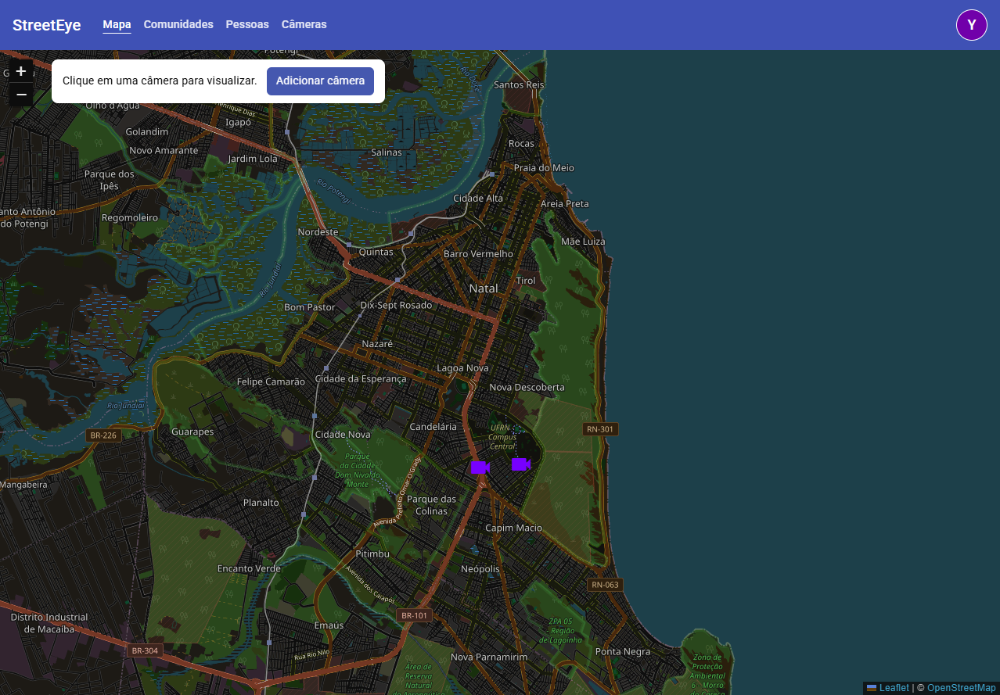
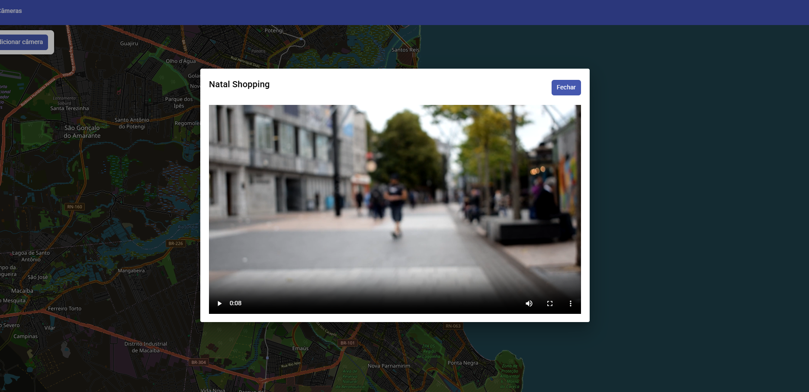
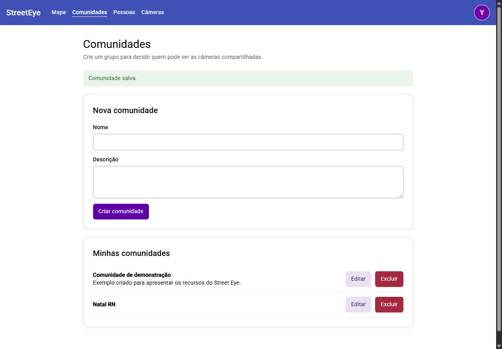
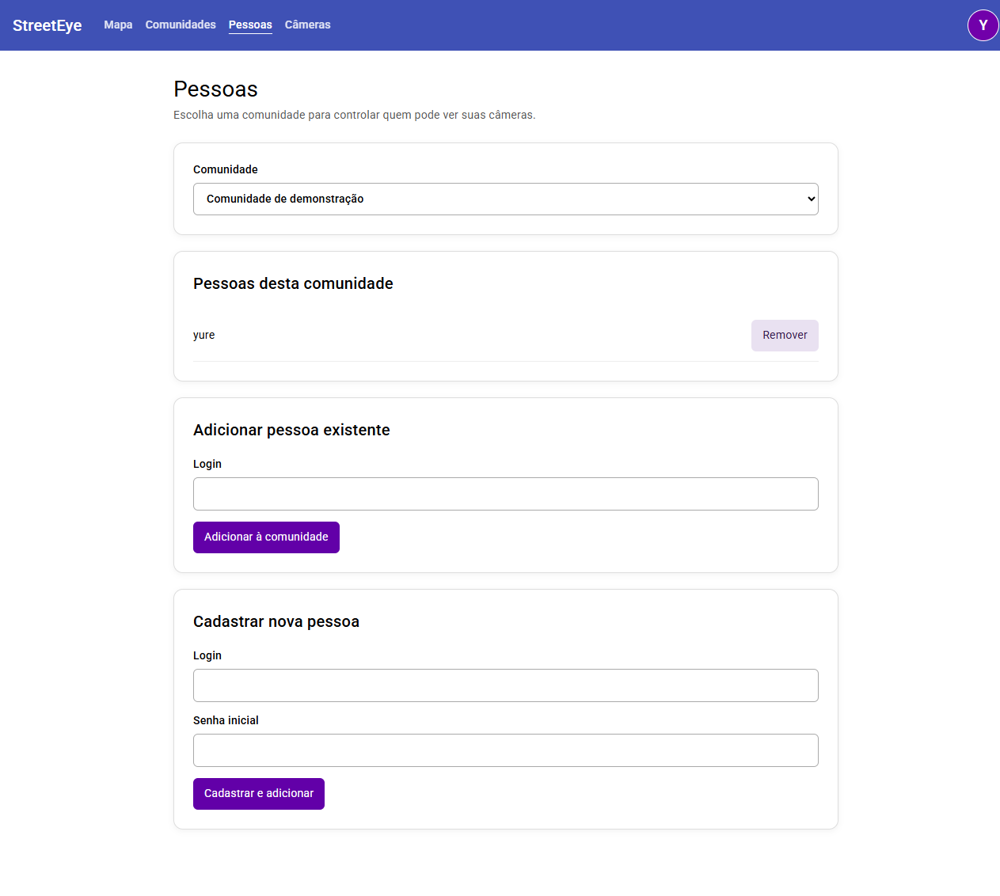

# Street Eye

Plataforma de compartilhamento de câmeras residenciais voltadas para a rua, organizadas por comunidades. Pelo mapa, os participantes localizam as câmeras compartilhadas e abrem o player para acompanhar a transmissão.



## Funcionalidades

- Cadastro de conta e autenticação por login e senha.
- Perfil com atualização de login e senha.
- Criação, edição e exclusão de comunidades.
- Participação em várias comunidades e gerenciamento de seus membros.
- Cadastro de câmeras escolhendo um ponto no mapa, um nome e uma comunidade.
- Listagem, alteração de nome e exclusão de câmeras.
- Mapa interativo com marcadores e reprodução de vídeo HLS.

Ao selecionar uma câmera no mapa, o player é aberto sobre a página:



## Comunidades e pessoas

A comunidade é a unidade de compartilhamento da plataforma. Cada câmera pertence a uma comunidade, e uma pessoa pode participar de várias delas. Ao criar uma comunidade, o usuário passa a integrar seu grupo de membros.



A tela de pessoas permite consultar os membros, adicionar uma conta existente pelo login ou cadastrar uma nova pessoa e vinculá-la à comunidade.



## Tecnologias

| Camada | Tecnologias |
| --- | --- |
| Frontend | Angular 19, TypeScript e Angular Material |
| Mapa | Leaflet e OpenStreetMap |
| Backend | Java 17, Spring Boot, Spring Security e JWT |
| Persistência | PostgreSQL 17, Spring Data JPA e Liquibase |
| Vídeo | FFmpeg, HLS e hls.js |
| Execução | Docker, Docker Compose e Nginx |

## Como funciona

O frontend consulta a API para carregar as comunidades do usuário e suas câmeras. As operações de gerenciamento de membros e câmeras verificam a participação do usuário na comunidade.

O produtor de vídeo executa o FFmpeg, que lê um MP4 em loop e gera uma playlist HLS e segmentos de vídeo. Esses arquivos ficam em uma pasta compartilhada com a API, que os entrega ao player do navegador.

```text
Navegador → Frontend Angular → API Spring Boot → PostgreSQL
                                  ↓
                              Arquivos HLS
                                  ↑
                         FFmpeg ← vídeo MP4
```

### Transmissão atual

Todas as câmeras reproduzem a mesma transmissão de demonstração, gerada a partir de um arquivo gravado. Ainda não existe uma fonte de vídeo individual por câmera nem integração com câmeras físicas em tempo real.

Os endpoints de vídeo são públicos. A regra de acesso por comunidade aplicada aos cadastros ainda não protege a playlist e os segmentos HLS.

## Executar com Docker Compose

Requisitos: Docker com Docker Compose disponível e as portas `4200`, `3000` e `5432` livres.

1. Disponibilize um vídeo MP4 em `stream/input/video.mp4`. Esse arquivo não é versionado e é necessário para construir a imagem do produtor de vídeo.
2. Na raiz do repositório, execute:

   ```sh
   docker compose up --build -d
   ```

3. Acesse a aplicação em [http://localhost:4200](http://localhost:4200).
4. Use **Criar conta** na tela de login e entre com as credenciais cadastradas. Crie uma comunidade e use **Adicionar câmera** no mapa para escolher sua localização.

| Serviço | Endereço local |
| --- | --- |
| Aplicação | `http://localhost:4200` |
| API | `http://localhost:3000` |
| Playlist HLS | `http://localhost:3000/video` |
| PostgreSQL | `localhost:5432` |

O Compose aguarda o PostgreSQL ficar saudável antes de iniciar a API. As configurações atuais incluem credenciais locais de desenvolvimento; revise-as antes de disponibilizar a aplicação em outro ambiente.

Para acompanhar os logs:

```sh
docker compose logs -f
```

Para parar os serviços mantendo os containers:

```sh
docker compose stop
```

## Estrutura do repositório

```text
frontend/          Interface Angular e configuração do Nginx
api/
  aplicacao/       Aplicação Spring Boot, autenticação e cadastros
  video/           Módulo de entrega da playlist e dos segmentos HLS
stream/            Produtor de vídeo com FFmpeg
docs/imagens/      Capturas de tela da aplicação
compose.yaml       Definição dos serviços em containers
```
